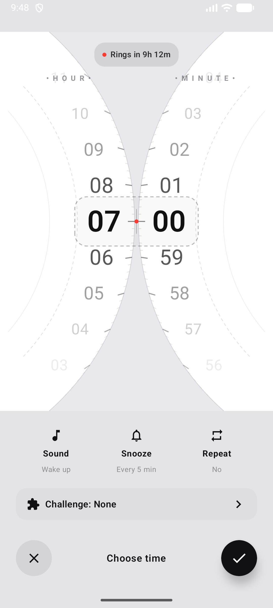
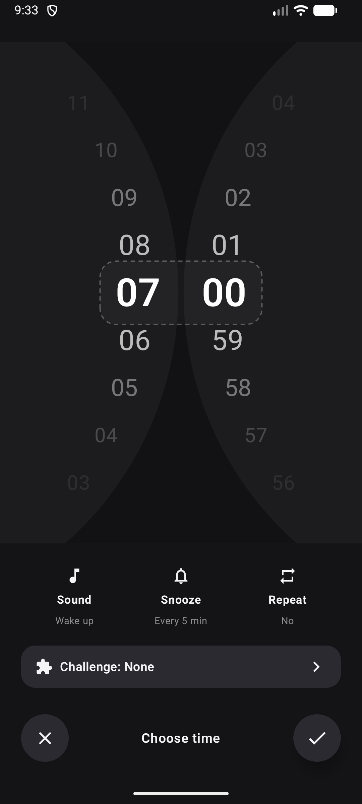
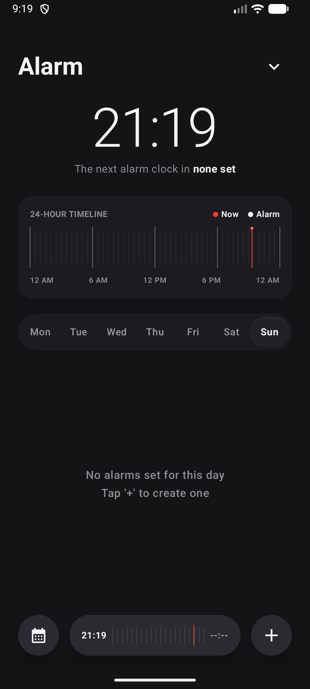

# OpenAlarm ⏰

<p align="center">
  
</p>

<p align="center">
  <strong>An ultra-reliable, privacy-first, beautifully crafted alarm clock for Android.</strong>
</p>

<p align="center">
  <a href="https://github.com/Nirajmeena2008/Open-Alarm/releases"></a>
  <a href="https://kotlinlang.org"></a>
  <a href="https://developer.android.com/jetpack/compose"></a>
  <a href="https://developer.android.com/about/versions/15"></a>
  <a href="LICENSE"></a>
</p>

---

## 🌟 Overview

**OpenAlarm** is a modern, high-precision alarm clock engineered for Android. Built with Jetpack Compose and modern Android architecture, OpenAlarm combines Swiss-watchmaker aesthetics with rock-solid alarm reliability. It guarantees you never miss an alarm while drawing **0% CPU/battery when idle**.

---

## ✨ Features

### 🎛️ Dual-Disc Curved Time Picker
- **Mathematical Circular Arc Geometry**: Two giant interacting wheels for Hours (`00`–`23`) and Minutes (`00`–`59`) with smooth spring-physics snapping.
- **Physical Bezel Graduation Ticks**: Synchronized mechanical graduation marks (major, half-step, and micro ticks) that rotate smoothly along the circular rim.
- **Acoustic & Tactile "Toci" Feedback**: A crisp mechanical ratchet click preloaded in RAM via Android `SoundPool` paired with clock-tick haptics for every degree of dial movement.
- **Live Ring Countdown**: Real-time floating status capsule calculating exact time remaining (`🔴 Rings in Xh Ym`).

### 🔋 100% Alarm Reliability, Zero Battery Drain
- **Kernel-Level RTC Wakeups**: Utilizes `AlarmManager.setAlarmClock()`, waking device hardware from the deepest Android Doze mode and aggressive OEM battery savers.
- **0% Idle CPU Drain**: No persistent foreground service or polling daemon required when closed. The OS kernel handles schedule wakeup.
- **10-Minute Safety Auto-Silence**: Protects device battery from complete drain if left unattended.
- **Doze & OEM Killer Immunity**: Built-in `REQUEST_IGNORE_BATTERY_OPTIMIZATIONS` whitelist integration.

### 🎨 Dynamic Themed App Icon
- **Synchronized Launcher Theme**: The home screen launcher icon dynamically switches between Light and Dark modes matching in-app appearance.
- **Adaptive Vector Motifs**: Clean minimalist clock face with high-contrast hands and precision red accent pip.

### 📊 24-Hour Timeline Ruler
- **Visual Schedule Overview**: Interactive 24-hour ruler with key temporal landmarks (`12 AM`, `6 AM`, `12 PM`, `6 PM`), live "Now" red marker, and active alarm pins.

### 📈 Gentle Gradual Volume Ramp
- **Gentle Wakeups**: Sound starts softly at 10% volume and smoothly escalates to 100% over 15s, 30s, 60s, or 2 minutes to prevent abrupt morning shock.

### 🧠 Heavy-Sleeper Dismiss Challenges
- **Math Challenge**: Solve arithmetic problems before dismiss.
- **Memory Sequence**: Simon-says style grid pattern memory challenge.
- **Shake Challenge**: Physical device shakes with accelerometer sensitivity.
- **NFC & QR Code**: Scan a physical tag or code in another room (e.g., bathroom) to silence the alarm.

### 🔒 100% Private & Local-First
- **No Internet Required**: Core alarm functionality runs completely offline without network permissions.
- **No Analytics / Telemetry**: Zero user tracking, telemetry, or remote data transmission.

---

## 📱 Screenshots

| Light Mode Dial | Dark Mode Dial | 24-Hour Timeline |
| :---: | :---: | :---: |
|  |  |  |

---

## 🏗️ Architecture

OpenAlarm is structured according to **Clean Architecture** with strict layer isolation:

```text
OpenAlarm/
├── app/                  # Application initialization, navigation, activity aliases
├── core/
│   ├── domain/           # Pure Kotlin domain (models, use cases, repository interfaces)
│   ├── data/             # Room 2.6 DB, DataStore, repository implementations
│   └── platform/         # AlarmManager, Audio, Notifications, Wear, Auto
├── feature/
│   ├── alarm/            # Dual-disc editor, timeline list, ringing activity, challenges
│   ├── sleep/            # Bedtime tracking, sleep routines, statistics
│   ├── settings/         # Appearance, battery optimization whitelisting
│   ├── developer/        # Optional isolated local HTTP/MQTT server
│   └── onboarding/       # Permission wizards & initial setup
├── wear/                 # Wear OS standalone app, tiles, and complications
└── auto/                 # Android Auto integration
```

---

## 🛠️ Tech Stack

- **Language**: [Kotlin 2.0+](https://kotlinlang.org)
- **UI Toolkit**: [Jetpack Compose (Material 3)](https://developer.android.com/jetpack/compose)
- **Architecture**: Clean Architecture + MVVM + UDF (Unidirectional Data Flow)
- **Asynchronous**: Kotlin Coroutines 1.8 + Reactive StateFlow
- **Database**: [Room 2.6](https://developer.android.com/training/data-storage/room)
- **Audio Engine**: Android `SoundPool` (sub-millisecond acoustic tick) + `MediaPlayer` (AudioAttributes `USAGE_ALARM`)
- **Haptics**: `HapticFeedbackConstants` segment and clock ticks
- **Widget**: Jetpack Glance (AppWidget)

---

## 🚀 Getting Started

### Prerequisites
- Android Studio Ladybug (2024.2+) or Koala
- JDK 17
- Android SDK 35 (compileSdk 35, minSdk 24)

### Building from Source

```bash
# Clone the repository
git clone https://github.com/Nirajmeena2008/Open-Alarm.git
cd Open-Alarm

# Build debug APK
./gradlew :app:assembleDebug

# Build optimized release APK
./gradlew :app:assembleRelease
```

The compiled release APK will be generated at:
`app/build/outputs/apk/release/app-release.apk`

---

## 📄 License

```text
Copyright 2026 OpenAlarm Contributors

Licensed under the Apache License, Version 2.0 (the "License");
you may not use this file except in compliance with the License.
You may obtain a copy of the License at

    http://www.apache.org/licenses/LICENSE-2.0

Unless required by applicable law or agreed to in writing, software
distributed under the License is distributed on an "AS IS" BASIS,
WITHOUT WARRANTIES OR CONDITIONS OF ANY KIND, either express or implied.
See the License for the specific language governing permissions and
limitations under the License.
```
